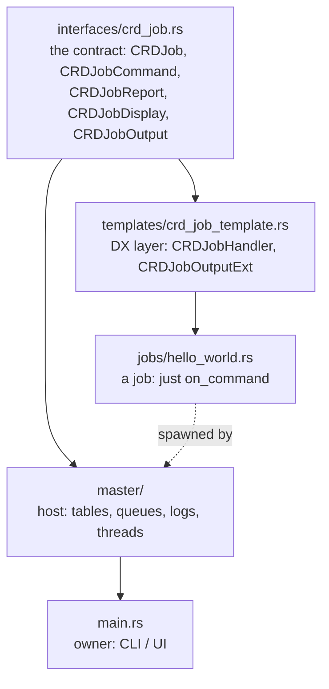
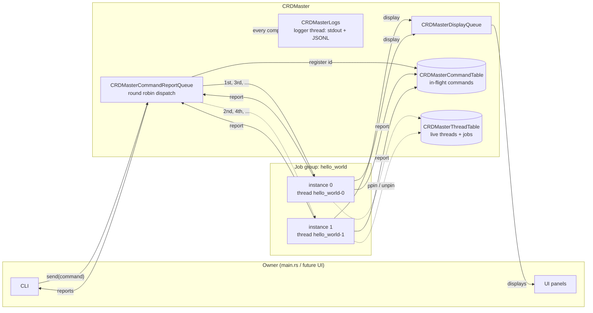
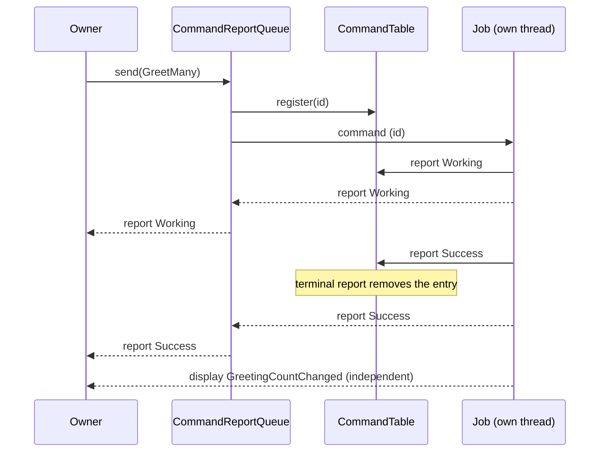
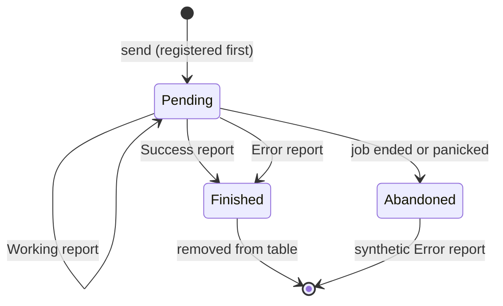
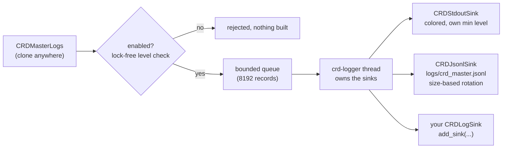

# CRD — Command · Report · Display

A small Rust runtime for hosting independent **jobs** on their own threads.
The owner talks to a job through three channels, and every job speaks the
same protocol:

| Channel | Direction | Meaning |
|---------|-----------|---------|
| **Command** | owner → job | "do this" |
| **Report**  | job → owner | progress or result of one command: `Working`\*, then exactly one `Success` or `Error` |
| **Display** | job → owner | unsolicited news: metrics, state changes, anything the job wants to publish |

The protocol is generic. Each job defines its own command, report and
display types. The owner never needs job-specific terminology to know
whether a command is running, done or failed.

## Layers



- **Contract** says what a job is. It has no threads and no transport.
- **Template** makes writing a job easy, and a job never writes `run`.
- **Master** gives jobs threads, queues, bookkeeping and logging.
- **main** is the owner. It sends commands and consumes reports and displays.

## Project layout

```text
src/
├── main.rs                      owner: CLI wired to the master
├── interfaces/
│   ├── mod.rs
│   └── crd_job.rs               the shared contract
├── templates/
│   ├── mod.rs
│   └── crd_job_template.rs      CRDJobHandler + output helpers
├── jobs/
│   ├── mod.rs
│   └── hello_world.rs           canonical example job
└── master/
    ├── mod.rs                   module map + re-exports
    ├── ids.rs                   ids, fast integer hasher, thread id
    ├── logs.rs                  CRDMasterLogs (logger thread) + sinks
    ├── command_table.rs         CRDMasterCommandTable
    ├── thread_table.rs          CRDMasterThreadTable
    ├── queues.rs                command/report queue, display queue
    └── runtime.rs               CRDMaster, CRDJobGroup, job threads
```

## Architecture



One job group is one job type running on 1..N instances, one OS thread each.
Most of the time N is 1. With N > 1, commands are distributed round robin,
and reports and displays from every instance merge into the group's queues.
Every envelope carries the `instance` it came from.

## Life of a command



The table is updated on the job's thread, before the owner sees the report.
When the owner reads a terminal report, the command is already gone from the
table.



## Writing a job

Three steps. A job never writes `run`, a thread, or a channel.

```rust
// 1. Command, report and display types.
#[derive(Debug)]
pub enum MyCommand { Ping, Add { a: u64, b: u64 } }

#[derive(Debug)]
pub enum MyReport { Pong, Sum(u64) }

#[derive(Debug)]
pub enum MyDisplay { Started }

// 2. Link the command to its report type.
impl CRDCommand for MyCommand {
    type ReportData = MyReport;
}

// 3. Implement the handler. CRDJob comes for free.
pub struct MyJob;

impl CRDJobHandler for MyJob {
    type Command = MyCommand;
    type CommandId = u64;          // required when hosted by CRDMaster
    type DisplayData = MyDisplay;

    fn on_start(&mut self, output: CRDHandlerOutput<'_, Self>) {
        output.publish_display(MyDisplay::Started);
    }

    fn on_command(&mut self, command: CRDHandlerCommand<Self>, output: CRDHandlerOutput<'_, Self>) {
        let CRDJobCommand { id, data } = command;
        match data {
            MyCommand::Ping => output.report_success_data(id, "pong", MyReport::Pong),
            MyCommand::Add { a, b } => match a.checked_add(b) {
                Some(sum) => output.report_success_data(id, "added", MyReport::Sum(sum)),
                None => output.report_error_message(id, "overflow"),
            },
        }
    }
}
```

`jobs/hello_world.rs` is the full reference. It covers single-step commands,
multi-step commands (`Working` reports, then one terminal report), `Error`
reports carrying data, queries, and every lifecycle hook.

**Rules every job follows**

- A command produces zero or more `Working` reports, then **exactly one**
  `Success` or `Error`. Never report after a terminal report. Never leave a
  command without one.
- Reports answer commands. Displays are for everything else.
- Message is for humans. Data is for programs. Both are optional.

**Output helpers (`CRDJobOutputExt`)**

| Helper | Status | Message | Data |
|--------|--------|---------|------|
| `report_working_message(id, msg)`    | Working | yes  | no   |
| `report_working(id, msg, data)`      | Working | opt. | opt. |
| `report_success_data(id, msg, data)` | Success | yes  | yes  |
| `report_success(id, msg, data)`      | Success | opt. | opt. |
| `report_error_message(id, msg)`      | Error   | yes  | no   |
| `report_error(id, msg, data)`        | Error   | opt. | opt. |
| `publish_display(data)`              | (display) | -  | yes  |

A job that needs full control can implement `CRDJob::run` by hand instead.
A type implements either `CRDJobHandler` or `CRDJob`, never both.

## Hosting a job

```rust
let logs = CRDMasterLogs::new();
logs.add_sink(CRDStdoutSink::new(CRDLogLevel::Info));

let master = CRDMaster::new(logs);

// one instance on one thread
let mut group = master.spawn("hello_world", vec![CRDHelloWorld::new()])?;

// or three instances, round robin
// let mut group = master.spawn("hello_world", vec![a, b, c])?;

let id = group.queue().send(CRDHelloWorldCommand::GetGreetingCount)?;

while let Ok(envelope) = group.queue().recv_report_timeout(Duration::from_secs(1)) {
    println!("{:?}", envelope.report);
    if envelope.report.command_id == id && crd_is_terminal(envelope.report.status) { break; }
}

// hand displays to a UI thread
let displays = group.take_display_queue();

group.shutdown(); // also runs on drop
logs.shutdown();  // drain the log queue and join the logger thread
```

Requirements on a hosted job: `CommandId = u64`, and `Command`, `ReportData`
and `DisplayData` implement `Debug`.

## The master mechanisms

| Mechanism | Type | Purpose |
|-----------|------|---------|
| Command table | `CRDMasterCommandTable` | commands sent and not yet finished, with their report history |
| Thread table  | `CRDMasterThreadTable`  | live threads and the jobs pinned to them |
| Command/report queue | `CRDMasterCommandReportQueue<C, R>` | per job group: round-robin dispatch out, merged reports in |
| Display queue | `CRDMasterDisplayQueue<D>` | per job group: merged unsolicited displays |
| Logs | `CRDMasterLogs` | async multi-sink logging on its own thread |

### Command table: built for speed

```text
 command id ──► id & 15 ──► shard 0 .. shard 15
                             each: Mutex<HashMap<u64, Record, CRDIdBuildHasher>>
                             each: 64-byte aligned (no false sharing)
```

- **Sharded:** 16 independent locks. Ids are sequential, so load spreads
  evenly and different commands almost never contend.
- **Integer hasher:** one multiply instead of SipHash. The keys are ids we
  generated, so hash-flooding resistance buys nothing.
- **Lock-free counters:** id generation and the pending count are atomics.
- **Short critical sections:** a lock covers one map operation.
- **Type-erased:** it stores ids, status, timing and messages, never job
  payloads, so one table serves every job type.
- **Bounded:** each record keeps its newest 32 report summaries.
  `report_count` still counts all of them.

### Thread table

A thread registers itself on start and unregisters on exit, even on panic.
It only ever holds threads that are still working. A thread can host
several jobs; the master currently starts one thread per job instance.

### Queues

- `send` assigns an id, **registers the command first**, then dispatches. A
  fast job can never report on an id the table has not seen.
- An instance that ended is skipped and the command is retried on the next
  one. If none accepts it, the command comes back in `CRDSendError`.
- Each queue has one consumer. Queues of different jobs are independent, so
  several consumers (UI panels) can read different jobs in parallel.

### Failure handling

If a job ends or panics with commands still pending, each one is removed
from the table, logged at `ERROR`, and answered with a synthetic `Error`
report. The owner is never left waiting. A report for an id that is not
pending (unknown, or sent after the terminal one) is logged as a protocol
violation.

## Logging

Logging never does formatting or I/O on the calling thread. A call site copies
the record into a bounded queue and returns. One `crd-logger` thread owns the
sinks, formats, writes and flushes.



A new destination is a type that implements `CRDLogSink` (`min_level`,
`write`, optional `flush`). The logger never changes. A sink is only ever
called from the logger thread, one record at a time, so it needs no locking.
Buffer in `write`, push data out in `flush`.

**Behaviour**

| Situation | What happens |
|-----------|--------------|
| Queue full, record is `Trace` or `Debug` | dropped and counted. When the backlog clears, one `N log records dropped (queue full)` warning is written |
| Queue full, record is `Info` or above | the caller waits for room, so lifecycle lines are never lost |
| `Warn` or `Error` record | flushed to the sinks immediately |
| `Error` record | the caller also waits (2 s at most) until it is flushed, so a crash cannot lose the line that explains it |
| Normal flow | sinks are flushed when the queue runs empty, and at least every 200 ms under continuous load |
| `logs.flush()` | writes everything queued so far and flushes the sinks |
| `logs.shutdown()` | drains the queue, flushes, joins the thread. Also happens when the last handle is dropped. Records logged afterwards are discarded |
| `logs.install_panic_hook()` | logs panics at `ERROR` and drains the queue before the previous hook runs |

Stdout line:

```text
12:00:00.123 INFO  tid=4242   crd.report command finished command=1 status=success job=hello_world instance=0 reports=2 elapsed_us=412
```

JSONL line (one object per line, flushed in batches):

```json
{"ts":"2026-11-09T12:00:00.123Z","ts_ms":1794225600123,"level":"INFO","source":"crd.report","tid":4242,"msg":"command finished","fields":{"command":1,"status":"success","job":"hello_world","instance":0,"reports":2,"elapsed_us":412}}
```

| Level | Used for |
|-------|----------|
| `TRACE` | command dispatch, `Working` reports, displays, payload dumps (`data=`, `command=`) |
| `DEBUG` | metadata only (nothing in the master uses it by default) |
| `INFO`  | job group and thread lifecycle, terminal `Success` reports |
| `WARN`  | `Error` reports, unreachable instances, protocol violations, dropped-record notice |
| `ERROR` | thread creation failure, panics, abandoned commands |

**Keeping logging cheap**

- Payload dumps (`format!("{:?}", ...)`) belong at `Trace`, behind
  `logs.enabled(CRDLogLevel::Trace)`. A disabled level costs one atomic load.
- Use `crd_static("job", name)` for `&'static str` values. It carries the
  string without allocating. `crd_field` copies a `&str`.
- Use `CRDFields::<N>` for a field list whose length varies, instead of a
  `Vec`.
- A record still costs one allocation for the message and one for the fields.

**JSONL rotation**

```rust
// start a new file at 10 MiB, keep app.jsonl.1 .. app.jsonl.5
CRDJsonlSink::open_with_rotation("logs/app.jsonl", CRDLogLevel::Info, 10 * 1024 * 1024, 5)?
```

`app.jsonl` becomes `app.jsonl.1`, `.1` becomes `.2`, and so on. The file past
the limit is deleted. Rotation runs on the logger thread. `CRDJsonlSink::open`
still gives an unbounded file.

Color turns on only when stdout is a terminal and `NO_COLOR` is unset.

## Running

```powershell
cargo run

# live detail on stdout
$env:CRD_LOG = "info"; cargo run

# payload dumps and per-progress records in the file (much more volume)
$env:CRD_LOG_FILE_LEVEL = "trace"; cargo run

# read the JSONL log
Get-Content logs\crd_master.jsonl -Tail 20
```

| CLI command | Effect |
|-------------|--------|
| `greet <name>` | single-step command |
| `greetmany a,b,c` | multi-step command: `Working` reports, then one terminal report |
| `count` | query |
| `cmds` | commands still pending (command table) |
| `threads` | live job threads and pinned jobs (thread table) |
| `help`, `exit` | |

| Setting | Default | Meaning |
|---------|---------|---------|
| `CRD_LOG` | `warn` | stdout level: trace, debug, info, warn, error |
| `CRD_LOG_FILE_LEVEL` | `info` | file level, same values. `trace` adds payload dumps and `Working` progress |
| `NO_COLOR` | unset | any value disables colors |
| `logs/crd_master.jsonl` | | JSONL file, appended to, rotated at 10 MiB, 5 old files kept (`.1` to `.5`) |

Windows colors need the `Win32_System_Console` feature of `windows-sys`:

```powershell
cargo add windows-sys --features Win32_System_Console
```

## Design principles

| Principle | Where |
|-----------|-------|
| **Single responsibility** | one file per mechanism: ids, logs, command table, thread table, queues, runtime |
| **Open / closed** | new log destination = new `CRDLogSink`. New job = new `CRDJobHandler`. Neither touches existing code |
| **Liskov** | every `CRDJobHandler` is a `CRDJob` through one blanket impl, and the master hosts any `CRDJob` |
| **Interface segregation** | jobs see only `CRDJobOutput`. Tables, queues and logs are invisible to them |
| **Dependency inversion** | jobs depend on the `CRDJobOutput` abstraction. The master supplies the implementation. The logger depends on the `CRDLogSink` trait |
| **Never block the hot path** | call sites only enqueue. All formatting and I/O happens on the logger thread |

## Limits and roadmap

- A group's instance count is fixed at spawn (`add_instance` exists
  internally, with no public scale-up yet).
- Each report and display queue has one consumer (`mpsc`).
- `Debug` is required on job payloads for logging.
- Command ids are master-assigned `u64` counters.
- The log queue is bounded. `Info` and above wait when it is full, so a
  stuck sink can stall callers. `Trace` and `Debug` are dropped and counted.
- A hard crash (abort, power loss) can lose records still in the queue.
  `Error` records and panics are flushed first.
- Per-`Working` progress streams are not sampled, only moved to `Trace`.
- Not yet built: JSON configuration, graceful per-command cancellation.